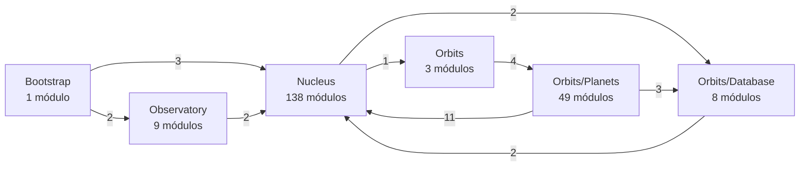

# SOLAR — Análise Estrutural e Validação Quantitativa da Arquitetura

**Data da análise:** 22/10/2026
**Raiz analisada:** `C:\Users\Win\OneDrive\Desktop\html\SOLAR`
**Ambiente:** Python 3.14.7 · Radon 6.0.1 · flake8 7.4.1 + flake8-cognitive-complexity 0.1.0
**Código-fonte:** a aplicação de produção não foi modificada. As ferramentas e os artefatos da auditoria estão em `observatory/audits/estrutural/`.

---

## 0. Sumário executivo

| Dimensão                               | Resultado medido                                                                                                                                       |
| -------------------------------------- | ------------------------------------------------------------------------------------------------------------------------------------------------------ |
| Corpus                                 | 269 arquivos `.py` (208 módulos de produção + 61 de teste); 11.785 SLOC totais, 6.261 de produção                                                      |
| Reprodutibilidade dos relatórios Radon | 100% — 208/208 arquivos de CC, 269/269 de Halstead, raw e MI, com **0 divergências**                                                                   |
| Complexidade ciclomática (produção)    | 553 funções/métodos, soma 1.278, média 2,31, mediana 2, **máximo 10**; 94,6% em rank A, nenhum bloco acima de B                                        |
| Complexidade cognitiva                 | 300 funções com pontuação ≥ 1; média 2,65; **máximo 18**; apenas **1** função acima de 15                                                              |
| Halstead                               | Volume total 19.918,75; produção 6.094,74 (30,6%); **45,50% das funções têm N1=N2=0** (52,62% na produção; limitação do Radon)                         |
| Manutenibilidade                       | 269/269 rank A; média 84,5; **a métrica não discrimina** e é distorcida pelo termo de comentários                                                      |
| Acoplamento interno                    | 208 módulos, **306 arestas** internas; Ce máx. 49, Ca máx. 38; 83,3% das arestas são intra-Nucleus                                                     |
| Ciclos                                 | **0 ciclos estáticos**; **1 ciclo real** (`nucleus.database.database ↔ orbits.database.models.user_model`) revelado por import dinâmico                |
| Alcançabilidade                        | 15 módulos com código no grafo estático (631 SLOC); tracing de runtime confirmou **14 ausentes (625 SLOC, 9,98%)** e refutou 1 (`observatory.records`) |
| CBO (aprox. AST)                       | 136 classes; média 1,54; mediana 1; máximo 15 (`Kernel`)                                                                                               |
| Coesão                                 | 136 classes; LCOM aplicável em apenas **39 (28,7%)**; 97 não aplicáveis; LCOM4 > 1 em **4** classes                                                    |
| Relatório estrutural original          | 60 alertas: 7 confirmados, 7 falsos positivos, 43 parciais, 1 não reproduzível, 2 confirmados fora do escopo                                           |

**Conclusão central:** a SOLAR medida é uma arquitetura de **governança** — 63% do SLOC de produção e 72% da complexidade cognitiva estão no subsistema de regras (`nucleus/rules`), enquanto os Planets somam 2,5% do SLOC. O acoplamento interno é baixo e **não há ciclos estáticos**, mas existe **um ciclo real** entre a fachada `Database` (Nucleus) e o Model (Orbits) que só aparece quando imports dinâmicos são considerados, além de **10,1% do código de produção inalcançável** a partir do bootstrap.

---

## 1. Inventário dos materiais e verificação de existência

### 1.1 Arquivos solicitados

| Arquivo solicitado                  | Existe?         | Como foi produzido / tratamento                                                                                                                                                                                                         |
| ----------------------------------- | --------------- | --------------------------------------------------------------------------------------------------------------------------------------------------------------------------------------------------------------------------------------- |
| Código-fonte SOLAR                  | sim             | 269 `.py`; AST com `ast.parse` (0 erros de sintaxe)                                                                                                                                                                                     |
| `complexidade.json`                 | sim             | Radon `cc -j`; 208 arquivos. Ficam de fora 61 arquivos sem funções/classes: 59 `__init__.py` sem código, 1 `__init__.py` só com reexportações (`observatory.records`) e 1 módulo vazio (`orbits/planets/auth/repository/repository.py`) |
| `halstead.json`                     | sim             | Radon `hal -j`; 269 arquivos                                                                                                                                                                                                            |
| `manutenibilidade.json`             | sim             | Radon `mi -j`; 269 arquivos                                                                                                                                                                                                             |
| `tamanho.json`                      | sim             | Radon `raw -j`; 269 arquivos                                                                                                                                                                                                            |
| `relatorio_estrutural.csv` / `.txt` | sim             | 60 alertas; ferramenta de code smells **não presente no repositório** (não reproduzível como ferramenta)                                                                                                                                |
| `solar_acoplamento_modulos.csv`     | **não existia** | **Produzido agora** por `solar_metrics.py`                                                                                                                                                                                              |
| `solar_cbo_classes_estimado.csv`    | **não existia** | **Produzido agora** (aproximação por AST, declarada)                                                                                                                                                                                    |
| `solar_cbo_coesao_validacao.csv`    | **não existia** | **Produzido agora**                                                                                                                                                                                                                     |
| `solar_ciclos_internos.json`        | **não existia** | **Produzido agora** (Tarjan + imports dinâmicos)                                                                                                                                                                                        |

Os quatro arquivos ausentes não foram "corrigidos": foram **criados**, porque não havia dados originais a preservar. Os cinco arquivos existentes foram preservados intactos; toda divergência é registrada em `alertas_estruturais_revisados.csv`.

### 1.2 Corpus e exclusões

| Conjunto          | Arquivos | SLOC       | Funções/métodos | Classes |
| ----------------- | -------- | ---------- | --------------- | ------- |
| Produção          | 208      | 6.261      | 553             | 136     |
| Testes (`tests/`) | 61       | 5.524      | 680             | 29      |
| **Total**         | **269**  | **11.785** | **1.233**       | **165** |

Excluídos: `.git`, `__pycache__`, `.pytest_cache`, `htmlcov`, `reports`, `docs`, `docker` e a pasta de dados `storage/` (apenas no primeiro nível — `nucleus/storage/` **foi incluído**, correção importante em relação a uma primeira versão da medição).

> **Nota metodológica:** os relatórios Radon existentes incluem os testes (269 arquivos). As métricas de arquitetura deste relatório usam **somente produção**; quando o valor inclui testes, isso é dito explicitamente.

---

## 2. Validação dos relatórios existentes

### 2.1 Reprodução integral

O Radon 6.0.1 foi executado novamente sobre o código atual e comparado campo a campo com os JSONs:

| Relatório                               | Arquivos comparados | Divergências                           |
| --------------------------------------- | ------------------- | -------------------------------------- |
| `complexidade.json` (CC)                | 208                 | **0**                                  |
| `halstead.json` (volume total)          | 269                 | **0**                                  |
| `tamanho.json` (loc/lloc/sloc/comments) | 269                 | **0**                                  |
| `manutenibilidade.json` (MI)            | 269                 | **0** (diferença máxima absoluta: 0,0) |

**Conclusão:** os quatro JSONs são autênticos e reproduzíveis. O problema não é o Radon; é **como os resultados são interpretados** (mistura de testes, uso de MI, Halstead com zeros).

### 2.2 O que o JSON de CC não contém

`complexidade.json` tem 208 chaves, não 269. A diferença de 61 arquivos foi verificada um a um: **59 `__init__.py` sem código**, **1 `__init__.py` com apenas reexportações** (`observatory/records/__init__.py`, que tem `import` e `__all__`, mas nenhuma função ou classe) e **1 módulo vazio** (`orbits/planets/auth/repository/repository.py`, 0 byte). Nenhum deles possui função ou método, portanto não há omissão de código com lógica na métrica de CC. A afirmação anterior de que seriam "61 `__init__.py` vazios" era imprecisa e está corrigida aqui.

### 2.3 Divergência entre "qualidade do código" e "arquitetura"

Os relatórios de qualidade medem o **repositório inteiro**, incluindo 5.524 SLOC de testes (46,9% do total). Isso explica por que:

- o volume Halstead "do projeto" (19.918,75) é **3,3×** o da produção (6.094,74);
- o maior fan-in interno listado abaixo é de um módulo de exceção usado em testes;
- alertas de LOC recaem sobre arquivos de teste.

---

## 3. Complexidade e tamanho

### 3.1 O que foi medido

| Métrica                       | Definição                                                       | Ferramenta                        | Escopo                                                                 |
| ----------------------------- | --------------------------------------------------------------- | --------------------------------- | ---------------------------------------------------------------------- |
| Complexidade ciclomática (CC) | número de caminhos independentes; Radon = pontos de decisão + 1 | Radon `cc`                        | funções e métodos (blocos `class` excluídos da soma para não duplicar) |
| Complexidade cognitiva        | custo de leitura: +1 por quebra de fluxo linear, +aninhamento   | flake8-cognitive-complexity 0.1.0 | mesmas funções de produção                                             |
| Tamanho de função             | `endline − lineno + 1`                                          | Radon `cc`                        | funções e métodos                                                      |
| LOC/SLOC/LLOC                 | linhas físicas / de código / lógicas                            | Radon `raw`                       | todos os arquivos                                                      |

**Não medido:** complexidade essencial, fan-in/fan-out de dados, profundidade de herança, acoplamento aferente/efferente por classe (apenas por módulo).

### 3.2 Resultados — CC

| Conjunto | N   | Soma  | Média | Mediana | P90 | Máx.   | Rank A      | Rank B    |
| -------- | --- | ----- | ----- | ------- | --- | ------ | ----------- | --------- |
| Produção | 553 | 1.278 | 2,31  | 2       | 5   | **10** | 523 (94,6%) | 30 (5,4%) |
| Testes   | 680 | 1.468 | 2,16  | 2       | 5   | 10     | 653         | 27        |

Nenhum bloco atinge rank C (CC ≥ 11). A distribuição é fortemente concentrada à esquerda: **mediana 2**, e apenas **30 funções (5,4%)** têm CC ≥ 6.

**Funções de maior CC (produção):**

| Módulo                                                | Função                               | CC    | Linhas  |
| ----------------------------------------------------- | ------------------------------------ | ----- | ------- |
| `nucleus.rules.scanner.error_exposure_scanner`        | `ErrorExposureScanner._destination`  | 10    | 85      |
| `observatory.records.error_log`                       | `ErrorLog.record`                    | 9     | 28      |
| `nucleus.rules.scanner.controller_return_scanner`     | `ControllerReturnScanner._scan_file` | 8     | 58      |
| `nucleus.rules.scanner.error_exposure_scanner`        | `ErrorExposureScanner._detail`       | 8     | 39      |
| `nucleus.rules.scanner.controller_auth_check_scanner` | `_checks` / `_abort_check`           | 7 / 7 | 35 / 35 |
| `nucleus.rules.scanner.error_exposure_scanner`        | `_assignments`                       | 7     | 32      |
| `nucleus.rules.scanner.http_input_scanner`            | `_methods`                           | 7     | 33      |

**Módulos com maior soma de CC:**

| Módulo                                          | Soma CC | CC máx. | Funções | SLOC |
| ----------------------------------------------- | ------- | ------- | ------- | ---- |
| `nucleus.rules.scanner.error_exposure_scanner`  | 79      | 10      | 17      | 273  |
| `nucleus.rules.scanner.mass_assignment_scanner` | 44      | 7       | 11      | 159  |
| `nucleus.rules.scanner.token_security_scanner`  | 39      | 7       | 11      | 129  |
| `nucleus.rules.scanner.http_input_scanner`      | 33      | 7       | 9       | 128  |
| `nucleus.rules.scanner.unsafe_sql_scanner`      | 31      | 7       | 10      | 104  |

### 3.3 Resultados — tamanho de função

N = 553; mínimo 2; mediana 13; média 16,6; P90 35; máximo **163** (`Kernel.mount`, CC = 2).
Funções com mais de 30 linhas: **76 (13,7%)**; mais de 50: **12 (2,2%)**; mais de 100: **2 (0,4%)**.

As duas funções com mais de 100 linhas são `Kernel.mount` (163) e `ArchitectureScanner._scan_file` (108). O tamanho alto de `mount` **não** vem de ramificação (CC = 2): é uma sequência de montagem.

### 3.4 Distribuição por camada

| Camada          | Módulos | SLOC  | Funções | Soma CC | CC máx. | CC média/função |
| --------------- | ------- | ----- | ------- | ------- | ------- | --------------- |
| Bootstrap       | 1       | 73    | 6       | 11      | 3       | 1,83            |
| Nucleus         | 138     | 5.533 | 494     | 1.169   | 10      | 2,37            |
| Observatory     | 9       | 388   | 26      | 63      | 9       | 2,42            |
| Orbits          | 3       | 12    | 1       | 1       | 1       | 1,00            |
| Orbits/Database | 8       | 96    | 5       | 7       | 2       | 1,40            |
| Orbits/Planets  | 49      | 159   | 21      | 27      | 4       | 1,29            |

**Leitura:** a camada de governança (Nucleus) concentra 88,4% do SLOC e 91,5% da CC somada. `nucleus/rules` sozinho tem 75 módulos, 3.942 SLOC (**63,0%** da produção) e soma CC 829 (**64,9%** do total). Os Planets — os módulos funcionais — têm 159 SLOC (2,5%) e CC somada 27 (2,1%).

---

## 4. Complexidade cognitiva

**Método:** `flake8 --select=CCR --max-cognitive-complexity=0` (plugin `flake8-cognitive-complexity` 0.1.0), sobre `nucleus/`, `orbits/`, `observatory/` e `server.py`. Com limiar 0, **toda** função com escore ≥ 1 é emitida; funções ausentes têm escore 0.

**Ressalva:** o plugin é uma implementação inspirada na especificação de Sonar, não o SonarQube oficial. Os valores são comparáveis entre si neste projeto, mas **não** com relatórios de outras ferramentas.

| Estatística                        | Valor        |
| ---------------------------------- | ------------ |
| Funções com escore ≥ 1             | 300 (de 553) |
| Soma                               | 794          |
| Mediana                            | 2            |
| Média                              | 2,65         |
| P90                                | 6            |
| Máximo                             | **18**       |
| Funções acima de 15 (limiar usual) | **1** (0,3%) |

**Maiores escores:**

| Função                                     | Escore | CC  |
| ------------------------------------------ | ------ | --- |
| `ErrorExposureScanner._destination`        | 18     | 10  |
| `ControllerReturnScanner._scan_file`       | 14     | 8   |
| `TokenSecurityScanner._verifies_signature` | 13     | —   |
| `UploadHandlingScanner._primitives`        | 10     | —   |
| `Identity._persist`                        | 10     | —   |

**Distribuição por camada:** Nucleus 752 (94,7% do total), Observatory 30, Bootstrap 5, Orbits/Database 2, Orbits/Planets 5, Orbits 0.

**Interpretação sustentada pelos dados:** a complexidade cognitiva acompanha a CC e confirma que o custo de leitura está concentrado nos analisadores estáticos do próprio Nucleus. Apenas `_destination` cruza o limiar de 15 — e é também a função de maior CC (10) e uma das mais longas (85 linhas).

---

## 5. Halstead

**Definições (Radon):** η1 = operadores distintos, η2 = operandos distintos, N1/N2 = ocorrências, V = N·log₂(η), D = (η1/2)·(N2/η2), E = D·V, B = V/3000.

| Estatística             | Total (API do Radon) | Total (`halstead.json`) | Produção         |
| ----------------------- | -------------------- | ----------------------- | ---------------- |
| Módulos                 | 269                  | 269                     | 208              |
| Volume (V)              | 19.918,75            | 19.918,75               | **6.094,74**     |
| Funções analisadas      | **1.233**            | 1.219                   | **553**          |
| Funções com N1 = N2 = 0 | **561 (45,50%)**     | **548 (44,95%)**        | **291 (52,62%)** |

> **Duas contagens diferentes.** A API do Radon devolve uma **lista** de funções (1.233); o JSON do CLI guarda um **dicionário por nome** e sobrescreve homônimos (1.219, isto é, 14 funções perdidas: 1 na produção em `nucleus/rules/report.py`, onde `status` existe em duas classes, e 13 em testes). O percentual de zeros também difere: 45,50% na API e 44,95% no JSON. Na produção, a proporção é **52,62%** (291 de 553).

**Limitação material (não é detalhe):** o visitante Halstead do Radon **não conta chamadas de função nem acesso a atributos**. Métodos que só orquestram chamadas recebem `N1 = N2 = 0` e volume zero. Exemplos: `ErrorLog` tem 12 funções e **8 com Halstead zero**; `ErrorExposureScanner` tem 4 de 17. Consequências:

1. o volume por função é **inválido para 45,50% das funções** no corpus (52,62% na produção);
2. o volume por módulo é um **limite inferior**;
3. o volume "do projeto" é dominado pelos testes (69,4%), não pela arquitetura.

**Maiores volumes de produção:** `error_exposure_scanner` 555,89 (17 funções, 4 com zero), `token_security_scanner` 276,74, `mass_assignment_scanner` 230,82, `error_log` 201,91 (8 de 12 zero), `url_guard` 201,18.

**Pendência:** Halstead confiável exigiria outro visitante (contando `Call`, `Attribute`, subscript e literais). Não foi implementado para não introduzir uma métrica caseira incompatível com o relatório original.

---

## 6. Índice de manutenibilidade (MI)

### 6.1 Fórmula efetivamente usada pelo Radon

```
MI = max(0, min(100, (171 − 5,2·ln V − 0,23·CC − 16,2·ln LLOC
                        + 50·sen(√(2,46·rad(percentual_de_comentários)))) · 100/171))
```

com `V` = volume Halstead total do arquivo, `CC` = `ComplexityVisitor.total_complexity` (não a soma dos blocos de `cc`), `LLOC` = `raw.lloc` (não SLOC), e o percentual de comentários = `(comments + multi) / sloc · 100`. Se `V ≤ 0` ou `LLOC ≤ 0`, o Radon retorna **100,0**.

### 6.2 Resultados

| Conjunto              | N   | Mín.  | Mediana | Média | Rank A     |
| --------------------- | --- | ----- | ------- | ----- | ---------- |
| Todos os 269 arquivos | 269 | 32,26 | 87,82   | 84,53 | 269 (100%) |
| Produção              | 208 | 32,26 | 100,0   | 88,14 | 208 (100%) |

**O MI não discrimina nada neste código:** 100% dos arquivos são rank A, e a mediana da produção é exatamente 100 (limite superior). Isso decorre de módulos curtos e de `LLOC` baixo.

### 6.3 Distorção pelo termo de comentários

O mínimo (32,26) é `nucleus/contracts/http_input.py`: **15 SLOC**, LLOC 23, V 86,04, CC 3 — ou seja, um arquivo pequeno e simples. O percentual de comentários calculado pelo Radon é **393,33%** (docstring multilinha contada como comentário sobre 15 SLOC), o que torna o termo senoidal negativo e derruba o MI.

**Análise de sensibilidade (reproduzível):** recalculando com `count_multi=False` (docstrings não contam como comentário), **26 dos 208 módulos** variam mais de 10 pontos e o delta médio é **+2,87**; o mínimo sobe para 50,35. A maior variação individual é de **+47,62 pontos** (`nucleus/contracts/http_input`: 32,26 → 79,88).

**Conclusão:** o MI publicado é aritmeticamente correto e reproduzível, mas **não deve ser usado como evidência de qualidade** nesta base. Ele mistura tamanho, Halstead incompleto e um termo de comentários instável.

---

## 7. Acoplamento

### 7.1 Definições e método

| Métrica         | Definição operacional                                                                     |
| --------------- | ----------------------------------------------------------------------------------------- |
| Fan-out (Ce)    | nº de **módulos internos distintos** importados por um módulo                             |
| Fan-in (Ca)     | nº de **módulos internos distintos de produção** que importam um módulo                   |
| Fan-in de teste | nº de módulos de teste que importam o módulo — **coluna separada**, nunca somada          |
| Instabilidade   | `I = Ce / (Ca + Ce)`; indefinida quando `Ca + Ce = 0` (registrada como vazio, não como 0) |
| CBO             | nº de **outras classes** referenciadas (aproximação por AST; ver 7.6)                     |
| Ciclos          | componentes fortemente conexos (Tarjan iterativo)                                         |

**Resolução de imports:** `import a.b.c` → prefixo interno mais longo (`a.b.c`); `from x import y` → `x.y` se `x.y` for um módulo interno, senão `x`; imports relativos resolvidos pelo pacote do arquivo; imports dentro de funções, `try` e `if TYPE_CHECKING` contados e sinalizados na coluna `kinds`.

**Excluídos do acoplamento:** bibliotecas externas e stdlib (234 comandos de import, em `dependencias_externas.csv`), módulos de teste como origem e as dependências internas dos testes. Nenhum import ficou não resolvido (0).

### 7.2 Resultados agregados

| Métrica | N                      | Mín. | Mediana | Média | P90 | Máx.   |
| ------- | ---------------------- | ---- | ------- | ----- | --- | ------ |
| Ce      | 101 módulos com Ce > 0 | 1    | 3       | 3,03  | 4   | **49** |
| Ca      | 138 módulos com Ca > 0 | 1    | 1       | 2,22  | 3   | **38** |

Total: **208 módulos, 306 arestas internas**. Dos 59 `__init__.py` sem código, 58 não têm arestas e **1 tem Ca = 1** (`orbits.database.models`, alcançado pela importação dinâmica da fachada `Database`).

**Maiores fan-out:**

| Módulo                                | Ce  | Observação                     |
| ------------------------------------- | --- | ------------------------------ |
| `nucleus.rules.project_validator`     | 49  | registra 29 regras + scanners  |
| `nucleus.kernel`                      | 16  | composition root               |
| `nucleus.middleware.request_pipeline` | 6   |                                |
| `nucleus.database.database`           | 5   | inclui 2 arestas **dinâmicas** |
| `nucleus.upload.file_validator`       | 5   | não alcançável (ver 7.5)       |

**Maiores fan-in:**

| Módulo                               | Ca  | Interpretação               |
| ------------------------------------ | --- | --------------------------- |
| `nucleus.exceptions.solar_exception` | 38  | exceção-base, hub legítimo  |
| `nucleus.rules.rule`                 | 32  | contrato de regra           |
| `nucleus.rules.scanner.source_files` | 17  | infraestrutura de varredura |
| `nucleus.rules.scanner.dependency`   | 12  | modelo de dependência       |

**Instabilidade (módulos com Ca + Ce ≥ 3):**

| Módulo                                 | Ca  | Ce  | I     |
| -------------------------------------- | --- | --- | ----- |
| `nucleus.rules.project_validator`      | 2   | 49  | 0,961 |
| `nucleus.kernel`                       | 1   | 16  | 0,941 |
| `nucleus.upload.file_validator`        | 0   | 5   | 1,000 |
| `server`                               | 0   | 5   | 1,000 |
| `nucleus.rules.scanner.secret_scanner` | 1   | 5   | 0,833 |

Os dois módulos mais instáveis (`project_validator`, `kernel`) são, previsivelmente, os pontos de composição: dependem de muitos e quase ninguém depende deles.

### 7.3 Distribuição por camada

| Camada          | Módulos | Classes | SLOC  | Ca (soma) | Ce (soma) | I intra-camada¹ | I entre camadas² |
| --------------- | ------- | ------- | ----- | --------- | --------- | --------------- | ---------------- |
| Bootstrap       | 1       | 1       | 73    | 0         | 5         | 1,000           | 1,000            |
| Nucleus         | 138     | 118     | 5.533 | 273       | 258       | 0,486           | **0,143**        |
| Observatory     | 9       | 2       | 388   | 9         | 9         | 0,500           | 0,500            |
| Orbits          | 3       | 0       | 12    | 1         | 4         | 0,800           | 0,800            |
| Orbits/Database | 8       | 3       | 96    | 7         | 4         | 0,364           | 0,286            |
| Orbits/Planets  | 49      | 12      | 159   | 16        | 26        | 0,619           | 0,778            |

¹ soma de todas as arestas, incluindo intra-camada (255 das 306 são Nucleus→Nucleus).
² apenas arestas que cruzam fronteiras de camada — é o valor arquiteturalmente informativo.

**Matriz de arestas entre camadas:**

| De → Para           | Bootstrap | Nucleus | Observatory | Orbits | Orbits/Database | Orbits/Planets |
| ------------------- | --------- | ------- | ----------- | ------ | --------------- | -------------- |
| **Bootstrap**       | —         | 3       | 2           | —      | —               | —              |
| **Nucleus**         | —         | 255     | —           | 1      | 2               | —              |
| **Observatory**     | —         | 2       | 7           | —      | —               | —              |
| **Orbits**          | —         | —       | —           | —      | —               | 4              |
| **Orbits/Database** | —         | 2       | —           | —      | 2               | —              |
| **Orbits/Planets**  | —         | 11      | —           | —      | 3               | 12             |



**Leitura:** a direção dominante é Planets → Nucleus (11 arestas) e Orbit → Planets (4), coerente com o desenho. Há, porém, **3 arestas de Nucleus para Orbits** (`kernel → orbits.routes` e as duas dinâmicas `database → models`), que invertem a direção de governança declarada. O grafo completo (306 arestas) está em `dependencias_internas.csv`.

### 7.4 Ciclos e componentes fortemente conexos

| Grafo                        | Arestas | Ciclos | Detalhe                                                         |
| ---------------------------- | ------- | ------ | --------------------------------------------------------------- |
| Somente estático (AST)       | 304     | **0**  | nenhum SCC com mais de 1 nó                                     |
| Estático + imports dinâmicos | 306     | **1**  | `nucleus.database.database ↔ orbits.database.models.user_model` |

**Ciclo identificado (tamanho 2):**

```
nucleus.database.database  --(importlib.import_module, linha 167)-->  orbits.database.models.user_model
orbits.database.models.user_model  --(from nucleus.database.database import Database, linha 2)-->  nucleus.database.database
```

O aresta de ida nasce de `Database._import_models()`: `MODELS_PACKAGE = "orbits.database.models"` + `pkgutil.iter_modules` + `importlib.import_module(f"{...}.{name}")`. Um analisador puramente AST **não vê** essa dependência e conclui, incorretamente, que não há ciclos.

O ciclo é funcionalmente intencional (o Model só pode ser importado depois de `Database.init()`), mas **é um ciclo de dependência de módulo** e deve ser assim registrado: o Nucleus conhece e importa o Orbits em tempo de execução, e o Orbits importa o Nucleus em tempo de importação.

Há **207 SCCs para 208 nós** — ou seja, além do par acima, todos os componentes são triviais (nenhum outro ciclo, nem auto-import).

### 7.5 Alcançabilidade (achado não coberto pelos relatórios)

BFS nas arestas de produção a partir dos pontos de entrada declarados `server` e `observatory.solar.__main__`:

- **134 de 208 módulos alcançáveis**;
- **15 módulos com código não alcançáveis** = **631 SLOC = 10,08% da produção**.

> **Correção pelo tracing de runtime (22/10/2026):** `observatory.records` é carregado como pacote-pai de `observatory.records.error_log`. O total corrigido é **14 módulos / 625 SLOC (9,98%)**. O grafo estático não materializa a aresta implícita `submódulo → pacote-pai`. Ver `auditoria_final/runtime_tracing/RELATORIO_RUNTIME_TRACING.md`.

| Módulo                                                                       | SLOC | Situação                                                     |
| ---------------------------------------------------------------------------- | ---- | ------------------------------------------------------------ |
| `nucleus.upload.file_validator`                                              | 66   | subsistema de upload inteiro não conectado                   |
| `nucleus.upload.file_signatures`                                             | 74   | idem                                                         |
| `nucleus.upload.upload_policy`                                               | 65   | idem                                                         |
| `nucleus.upload.file_sanitizer`                                              | 29   | idem                                                         |
| `nucleus.upload.uploaded_file`                                               | 14   | idem                                                         |
| `nucleus.security.url_guard`                                                 | 92   | não instanciado no `Kernel.mount()`                          |
| `nucleus.middleware.csrf_protection`                                         | 54   | não instanciado no `Kernel.mount()`                          |
| `nucleus.middleware.rate_limiter`                                            | 28   | não instanciado no `Kernel.mount()`                          |
| `nucleus.middleware.brute_force_guard`                                       | 36   | não instanciado no `Kernel.mount()`                          |
| `nucleus.security.attempt_tracker`                                           | 39   | só usado por `brute_force_guard`                             |
| `nucleus.security.token`                                                     | 41   | **sem nenhum importador** (Ca = Ce = 0)                      |
| `nucleus.rules.architecture.controller_and_usecase_must_use_named_contracts` | 75   | regra existe, mas **não é registrada** no `ProjectValidator` |
| `nucleus.contracts.responsibility_contract`                                  | 6    | contrato não referenciado                                    |
| `orbits.planets.user.repository.user_repository`                             | 6    | Planet `user` não o utiliza                                  |
| `observatory.records` (`__init__`)                                           | 6    | pacote não importado como pacote                             |

Observações verificadas no código, não inferidas:

- `Kernel.mount()` instancia `SecurityPolicy`, `RequestPipeline`, `ErrorHandler` e `SecurityHeaders`, mas **não** `CsrfProtection`, `RateLimiter`, `BruteForceGuard` nem `UrlGuard`.
- `nucleus.security.token` define a classe `Token` (JWT) e não é importado por produção **nem por testes** (a ocorrência em `tests/rules/test_controller_security_scanner.py` está dentro de uma _string_ de fixture, não é um import).
- `ControllerAndUseCaseMustUseNamedContracts` é importado por um teste, mas não aparece em `project_validator.py`.

Isso é uma medida de **alcançabilidade estática**, não um julgamento: pode ser API pública deliberada ou código preparado para uso futuro. O dado relevante é que **10,1% do código de produção não participa do fluxo executável** e que 4 mecanismos de segurança declarados não estão ligados no ponto de montagem.

### 7.6 CBO — acoplamento entre classes (aproximação)

**Método (declaradamente aproximado):**

1. tabela de símbolos por módulo (import → módulo ou símbolo);
2. para cada classe, coleta de nomes simples e cadeias `a.b.c` em bases, anotações, chamadas e acessos;
3. resolução para classes internas via import; nomes não importados só são resolvidos se forem **únicos** no projeto;
4. nomes ambíguos entram em `cbo_internal_max` e não em `cbo_internal_min` (duas colunas publicadas);
5. CBO externo é estimado por símbolos importados com inicial maiúscula — heurística, não padrão.

| Estatística       | Valor                            |
| ----------------- | -------------------------------- |
| Classes           | 136                              |
| CBO interno médio | 1,54                             |
| Mediana           | 1                                |
| P90               | 3                                |
| Máximo            | **15** (`nucleus.kernel.Kernel`) |

**Maiores CBO interno:** `Kernel` 15, `RequestPipeline` 6, `ProjectValidator` 5, `Broadcast` 4, `ModelsMustLiveInTheirOwnFile` 4, `Server` 4, `Database` 3, `DriverSQLAlchemy` 3.

**Limitações (explícitas):** não resolve despacho dinâmico, injeção por atributo (`self.repo = X()` conta pelo nome de `X`, não pelo tipo real), classes criadas por fábrica nem tipos em _strings_. Portanto:

- **subestima** CBO em código com injeção de dependência;
- **não é comparável** a CBO de ferramentas Java/C++ (que resolvem tipos);
- os valores `min`/`max` delimitam a incerteza por ambiguidade de nomes (nenhuma classe apresentou ambiguidade relevante neste corpus).

---

## 8. Coesão

### 8.1 Método

Para cada classe de produção (136):

| Elemento                   | Regra                                                                                                      |
| -------------------------- | ---------------------------------------------------------------------------------------------------------- |
| Atributos de instância     | escritas `self.x = ...` em métodos de instância; `cls.x` conta como **estado de classe**, não de instância |
| Atributos de classe        | atribuições no corpo da classe, **excluindo constantes UPPER_CASE**                                        |
| Métodos                    | funções do corpo da classe; `@staticmethod`, `@classmethod` e `@property` classificados separadamente      |
| LCOM1 (CK)                 | `max(P − Q, 0)`, onde P = pares de métodos que não compartilham atributos e Q = pares que compartilham     |
| LCOM\* (Henderson-Sellers) | `((1/a)·Σμ(Aⱼ) − m) / (1 − m)`, exigindo `a > 0` e `m > 1`                                                 |
| LCOM4 (Hitz-Montazeri)     | nº de componentes conexos, aresta = atributo compartilhado **ou** chamada direta entre métodos             |
| TCC                        | `Q / C(m,2)`                                                                                               |
| Aplicabilidade             | N/A se `a = 0`, `m < 2` ou se nenhum método de instância usa o estado                                      |

**Decisões explícitas:**

- `__init__` e demais métodos especiais são **excluídos** do LCOM principal (inicializadores tocam todos os atributos e inflam a coesão). Uma variante com `__init__` é publicada (`lcom1_incl_init`) para auditoria do relatório original.
- Uma classe **sem atributos de instância não é "perfeitamente coesa"**: é **não aplicável**. O mesmo para fachadas `@classmethod`: o LCOM1 sobre atributos de instância é sempre `C(m,2)`.

### 8.2 Corpus e aplicabilidade

| Situação                                      | Classes        |
| --------------------------------------------- | -------------- |
| Com estado de instância                       | 49             |
| Sem estado de instância                       | 87             |
| **LCOM aplicável**                            | **39 (28,7%)** |
| N/A — menos de 2 métodos de instância         | 54             |
| N/A — sem atributos de instância              | 42             |
| N/A — nenhum método de instância usa o estado | 1              |
| **Total**                                     | **136**        |

Categorias: **39** com estado de instância, **50** funcionais/sem estado, **33** sem métodos de instância, **4** com estado único, **4** fachadas de estado de classe (`Database`, `Storage`, `Broadcast`, `UploadPolicy`) e **6** mistas (estado de instância + métodos de classe).

> **Nota:** 97 classes (71,3%) **não admitem** LCOM significativo. Qualquer média de LCOM calculada sobre todas as 136 classes — como faz implicitamente o relatório original — é dominada por artefatos.

### 8.3 Resultados (apenas classes aplicáveis, N = 39)

| Métrica | Mín. | Mediana | Média | P90  | Máx.   |
| ------- | ---- | ------- | ----- | ---- | ------ |
| LCOM1   | 0    | 3       | 10,82 | 30   | **89** |
| LCOM4   | 1    | 1       | 1,13  | 2    | **3**  |
| TCC     | 0,00 | 0,30    | 0,398 | 1,00 | 1,00   |

### 8.4 Casos extremos e interpretação

**LCOM1 alto com LCOM4 = 1 — classes de "helpers":**

| Classe                  | Atributos | Métodos | LCOM1 | LCOM4 | TCC   |
| ----------------------- | --------- | ------- | ----- | ----- | ----- |
| `ErrorExposureScanner`  | 1         | 14      | 89    | 1     | 0,011 |
| `MassAssignmentScanner` | 1         | 10      | 43    | 1     | 0,022 |
| `TokenSecurityScanner`  | 1         | 10      | 43    | 1     | 0,022 |
| `UnsafeSqlScanner`      | 1         | 9       | 30    | 1     | 0,083 |
| `HttpInputScanner`      | 2         | 8       | 28    | 1     | 0,000 |
| `RouteScanner`          | 2         | 9       | 28    | 1     | 0,111 |
| `UrlGuard`              | 2         | 8       | 26    | 1     | 0,036 |

Todas têm LCOM4 = 1: os métodos formam **um único componente conexo** por chamadas internas. O LCOM1 é sensível ao número de métodos (`C(14,2) = 91`), então 89 significa apenas "quase nenhum par compartilha o único atributo" — não que a classe tenha 89 "problemas". Essas classes são **funcionalmente coesas com estado mínimo** (o `root` do scanner). **Não devem ser tratadas como baixa coesão** com base em LCOM1 isolado.

**LCOM4 > 1 — candidatos reais a mais de uma responsabilidade (4 classes):**

| Classe                         | LCOM4 | Componentes observados                                                                                                                             | Veredito                                                                                                               |
| ------------------------------ | ----- | -------------------------------------------------------------------------------------------------------------------------------------------------- | ---------------------------------------------------------------------------------------------------------------------- |
| `DriverSQLAlchemy`             | **3** | (a) `connect`/`_build_connection_url`; (b) `session`/`health_check`/`disconnect`; (c) `orm`/`model` e `sync`/`_apply_changes` ligados por `engine` | **Confirmado**: ciclo de vida da conexão, vocabulário ORM e sincronização de esquema são três usos distintos do estado |
| `Kernel`                       | 2     | `mount`/`observe` compartilham `error_handler`; `shutdown` não toca estado                                                                         | **Limítrofe**: composition root; `shutdown` isolado é esperado                                                         |
| `SecretsMustNotAppearInSource` | 2     | `_is_justified` usa os 3 atributos; `_build_message` só chama `code()`                                                                             | **Provável artefato**: helpers funcionais em classe de regra                                                           |
| `ErrorLog`                     | 2     | escrita (`record`/`_insert`) vs leitura (`all`/`find`/`count`)                                                                                     | **Confirmado**: dois caminhos de acesso ao mesmo banco                                                                 |

### 8.5 Auditoria do LCOM original

O relatório original emitiu 5 alertas de LCOM. Aplicando a mesma fórmula (LCOM1 sobre atributos de instância, incluindo `__init__` quando necessário):

| Classe             | Publicado           | Recalculado                                                       | Veredito                                                                                              |
| ------------------ | ------------------- | ----------------------------------------------------------------- | ----------------------------------------------------------------------------------------------------- |
| `Database`         | 15 (P = 15, Q = 0)  | `a = 0` (6 `@classmethod`); **N/A**                               | **Falso positivo** — sem atributos de instância, P = C(6,2) por construção                            |
| `Storage`          | 15 (P = 15, Q = 0)  | `a = 0` (6 `@classmethod`); **N/A**; LCOM de estado de classe = 0 | **Falso positivo** — fachada `@classmethod`                                                           |
| `DatabaseDriver`   | 21 (P = 21, Q = 0)  | `a = 0` (ABC, 7 métodos abstratos); **N/A**                       | **Falso positivo** — interface sem estado                                                             |
| `DriverSQLAlchemy` | 12 (P = 27, Q = 15) | LCOM1 = **12**                                                    | **Parcial** — o valor coincide, mas **P + Q = 42 ≠ C(10,2) = 45**; o detalhamento publicado não fecha |
| `ErrorHandler`     | 11 (P = 19, Q = 8)  | LCOM1 = **19** (sem `__init__`) / **18** (com `__init__`)         | **Não reproduzível** — nenhuma variante resulta em 11; P + Q = 27 ≠ C(8,2) = 28                       |

**3 dos 5 alertas de coesão são falsos positivos** causados por aplicar LCOM a classes sem estado de instância. Nos outros dois, a contagem de pares publicada é aritmeticamente inconsistente com o número de métodos.

---

## 9. Revisão do relatório estrutural

### 9.1 Placar dos 60 alertas

| Veredito                                          | Alertas |
| ------------------------------------------------- | ------- |
| Confirmado                                        | 7       |
| Confirmado, mas fora do escopo de produção        | 2       |
| Parcial (valor reproduzido, métrica mal definida) | 43      |
| Falso positivo                                    | 7       |
| Não reproduzível                                  | 1       |

| Tipo de alerta           | Qtd. | Situação dominante                                                          |
| ------------------------ | ---- | --------------------------------------------------------------------------- |
| Too Many Branches        | 35   | ramos = CC − 1 em 22/35; **aninhamento publicado errado em 33/35**          |
| High Fan-in              | 7    | 4 são bibliotecas externas; 2 incluem testes; 1 não reproduzível exatamente |
| High Lines of Code (LOC) | 5    | "Total" = `loc`, mas detalhamento não soma                                  |
| High LCOM                | 5    | 3 falsos positivos, 1 parcial, 1 não reproduzível                           |
| Long File                | 4    | = SLOC do Radon (2 produção, 2 testes)                                      |
| High Fan-out             | 2    | reproduzidos, mas somam dependências externas                               |
| High NOM                 | 1    | confirmado (14 métodos)                                                     |
| High NOC                 | 1    | contagem total confere; "weighted" e "abstract" não                         |

### 9.2 Achados confirmados

- **Arquivos extensos (produção):** `nucleus/rules/scanner/error_exposure_scanner.py` (273 SLOC), `nucleus/rules/project_validator.py` (269 SLOC). O alerta de 267 linhas para `project_validator` difere em 2 do SLOC atual (parcial).
- **Métodos com muitas ramificações:** `_destination` (9 ramos, CC = 10), `_scan_file` do `ControllerReturnScanner` (7, CC = 8), `_checks`/`_abort_check` (6/5).
- **Fan-out elevado:** `project_validator` (49 internos + 2 externos) e `kernel` (16 + 2), confirmados.
- **NOM:** `ErrorExposureScanner` com 14 métodos (excluindo especiais) — confirmado.
- **Fan-in:** `nucleus.rules.rule` (32 + 1 teste) e `source_files` (17 + 1 teste) — confirmados, mas **o teste não deveria estar na métrica**.

### 9.3 Erros metodológicos identificados

**(a) Dependências externas tratadas como acoplamento arquitetural.**
Quatro dos sete alertas de fan-in são bibliotecas: `pathlib` (42), `pytest` (32), `dataclasses` (29), `ast` (20). Nenhum é módulo do projeto.

**(b) Testes somados ao fan-in.**
`rule` 33 = 32 + 1 e `source_files` 18 = 17 + 1 — reprodução exata. Em `solar_exception`, 38 de produção + 25 de teste = 63, mas o relatório publica 57: a origem desse número **não é reproduzível** com o código atual (pode ser versão anterior dos testes). Ainda assim, a ordem de grandeza (57 entre 38 e 63) evidencia a mistura.

**(c) Fan-out mistura interno e externo.**
`kernel` 18 = 16 internos + 2 externos; `project_validator` 51 = 49 + 2. O valor é reproduzível, mas a métrica não é "acoplamento interno".

**(d) "Max nesting" não é aninhamento.**
Nas 35 ocorrências, o aninhamento publicado varia de 4 a 9; a profundidade real de estruturas de controle varia de **1 a 5**, e só **2 de 35** coincidem. Em `_destination`, publicado 9 vs real **3**. O campo parece replicar a contagem de ramos, não a profundidade.

**(e) Contagem de ramos não é sempre CC − 1.**
22 de 35 coincidem; 13 divergem (ex.: `ArchitectureScanner._scan_file` publicado 6, CC = 6 → 5; `SecretScanner._scan_file` publicado 6, CC − 1 = 4).

**(f) LOC com componentes que não fecham.**
Exemplo: `project_validator` — Total 423 (= `raw.loc`), mas Code 216 + Doc 52 + Import 51 + Blank 53 = **372**. Faltam 51 linhas (docstrings multilinha). "Code" não corresponde a `loc`, `sloc` nem `lloc` (107) do Radon. "Meaningful lines" ≈ `sloc` (267 vs 269; 273 vs 273; 268 vs 268; 366 vs 366).

**(g) NOC não reproduzível no detalhe.**

- Regular 124 + Utility 12 = **136** = classes de produção medidas ✔
- Test classes 29 ✔
- "weighted 127,6" — **fórmula não documentada**, não reproduzível
- "Abstract/Interface 0" — **incorreto**: há **9** classes herdando diretamente de `ABC`/`Protocol`
- "Adjusted threshold 10.5" — sem derivação

**(h) LCOM** — ver seção 8.5.

### 9.4 O que o relatório estrutural não detectou

A ausência de alertas não é prova de ausência de problemas. A ferramenta original **não detectou**:

1. o ciclo `Database ↔ user_model` (invisível para AST);
2. 14 módulos inalcançáveis confirmados em runtime (625 SLOC) — o 15º, `observatory.records`, é carregado como pacote-pai;
3. a regra `ControllerAndUseCaseMustUseNamedContracts` não registrada no validador;
4. que 4 mecanismos de segurança não são instanciados no `Kernel.mount()`;
5. que 45,50% das funções têm Halstead inválido (52,62% na produção);
6. que o MI é 100 para 50% dos módulos e não discrimina.

---

## 10. Correções aplicadas e arquivos produzidos

### 10.1 O que foi corrigido (e por quê)

| Correção                            | Motivo                                                                                                                                                                                 |
| ----------------------------------- | -------------------------------------------------------------------------------------------------------------------------------------------------------------------------------------- |
| Separação produção × testes         | 5.524 SLOC de teste (46,9%) distorciam CC, Halstead, MI e fan-in                                                                                                                       |
| Fan-in com coluna `fan_in_tests`    | reproduz exatamente os valores 33 e 18 do relatório e isola a influência                                                                                                               |
| Fan-out interno separado do externo | 18 e 51 do relatório só fecham somando 2 dependências externas                                                                                                                         |
| LCOM com aplicabilidade explícita   | 3 dos 5 alertas eram classes sem estado de instância                                                                                                                                   |
| LCOM com/sem `__init__`             | necessário para auditar os valores publicados                                                                                                                                          |
| Deduplicação de métodos no CC       | o JSON do CLI do Radon repete cada método; somar tudo inflava contagens                                                                                                                |
| Inclusão de `nucleus/storage/`      | uma primeira versão excluía o pacote por homonímia com a pasta de dados `storage/`                                                                                                     |
| Imports dinâmicos                   | 2 arestas e **o único ciclo real** não existiam no grafo estático                                                                                                                      |
| MI recalculado pela API do Radon    | a fórmula caseira usada na **primeira versão da validação** usava SLOC e `2,4` em vez de LLOC e `2,46·rad()`, com erro de até 85 pontos; substituída pela API oficial (0 divergências) |
| Contagem de blocos                  | `blocks_all` chegou a ser calculado sobre a variável errada; corrigido para 1.395 blocos (162 classes + 1.233 funções/métodos)                                                         |

### 10.2 Arquivos gerados (`observatory/audits/estrutural/`)

| Arquivo                                                                 | Conteúdo                                                                           |
| ----------------------------------------------------------------------- | ---------------------------------------------------------------------------------- |
| `RELATORIO_CONSOLIDADO.md`                                              | este relatório                                                                     |
| `solar_metrics.py`                                                      | script reprodutível de todas as métricas próprias                                  |
| `revisar_relatorio.py`                                                  | auditoria item a item dos 60 alertas originais                                     |
| `solar_acoplamento_modulos.csv`                                         | Ca, Ce, I, fan-in de testes, CBO máx. por módulo                                   |
| `dependencias_internas.csv`                                             | 306 arestas internas (origem, destino, camadas, tipo, linhas)                      |
| `dependencias_externas.csv`                                             | 234 comandos de import externos (para provar a exclusão)                           |
| `solar_cbo_classes_estimado.csv`                                        | CBO por classe (min/max, alvos internos e externos)                                |
| `solar_cbo_coesao_validacao.csv`                                        | atributos, métodos, LCOM1, LCOM\*, LCOM4, TCC, aplicabilidade                      |
| `solar_ciclos_internos.json`                                            | SCCs, ciclos estáticos, arestas dinâmicas, ciclo real                              |
| `alcancabilidade.json`                                                  | módulos não alcançáveis e SLOC correspondente                                      |
| `alertas_estruturais_revisados.csv`                                     | os 60 alertas com valor publicado, recalculado, veredito e justificativa           |
| `modulos_metricas.csv`                                                  | consolidado por módulo (SLOC, CC, Halstead, MI, cognitiva, Ca/Ce, alcançabilidade) |
| `camadas_consolidado.csv` / `camadas_resumo.csv` / `matriz_camadas.csv` | agregados por camada e matriz de arestas                                           |
| `subcamadas_resumo.csv`                                                 | agregados por subcamada (útil porque Nucleus tem 138 módulos)                      |
| `funcoes_complexidade.csv`                                              | 1.233 funções com CC, rank, linhas e camada                                        |
| `complexidade_cognitiva.csv`                                            | 300 funções com escore ≥ 1                                                         |
| `radon_halstead_modulos.csv`                                            | Halstead por módulo, com contagem de funções zeradas                               |
| `validacao_radon.json`                                                  | prova de reprodução (0 divergências) e fórmula do MI                               |
| `resumo_metricas.json`                                                  | todos os agregados em formato de máquina                                           |

Os arquivos originais em `reports/quality/` foram **preservados sem alteração**.

---

## 11. Conclusões sustentadas pelos dados

1. **Os relatórios Radon são autênticos e reproduzíveis** (0 divergências em 208 arquivos de CC e 269 de Halstead/raw/MI). As falhas estão na interpretação, não na geração.
2. **A complexidade é baixa e homogênea.** CC máxima 10, média 2,31, 94,6% em rank A. Não há "hotspots" de complexidade ciclomática; há **duas** funções longas (`mount` 163 linhas, CC 2; `_scan_file` 108 linhas, CC 6) e **uma** função acima do limiar cognitivo usual (`_destination`, 18).
3. **O custo estrutural está no próprio mecanismo de governança.** `nucleus/rules` = 63,0% do SLOC, 64,9% da CC e 94,7% da complexidade cognitiva da produção. Os Planets somam 2,5% do SLOC. A arquitetura medida é, quantitativamente, um **motor de verificação arquitetural** com uma aplicação-exemplo mínima.
4. **O acoplamento interno é baixo e direcional.** 306 arestas para 208 módulos; 83,3% intra-Nucleus; mediana de Ce = 3 e Ca = 1. A direção dominante é Planet → Nucleus, como o desenho prevê.
5. **Não há ciclos estáticos, mas há 1 ciclo dinâmico real** entre `nucleus.database.database` e `orbits.database.models.user_model`. Conclusões de "zero ciclos" baseadas apenas em AST são **incompletas**.
6. **10,1% do SLOC de produção é inalcançável** a partir de `server`/CLI, incluindo todo o subsistema de upload e quatro mecanismos de segurança (CSRF, rate limit, brute force, URL guard) que não são instanciados no `Kernel.mount()`.
7. **A coesão não pode ser resumida por LCOM1.** 71,3% das classes não admitem a métrica; nas 39 aplicáveis, LCOM4 (máx. 3, média 1,13) e TCC (mediana 0,30) mostram que a maioria é coesa ou tem estado mínimo. Apenas 2–4 classes têm separação real de responsabilidades, e 3 dos 5 alertas originais eram falsos positivos.
8. **MI e Halstead, como publicados, não sustentam conclusões de qualidade.** MI é 100% rank A (não discrimina) e varia até **47,6 pontos** conforme a contagem de docstrings; Halstead é zero para **45,50%** das funções no corpus (**52,62%** na produção).
9. **O relatório estrutural tem 7 falsos positivos e 43 alertas parciais em 60.** Os erros são sistemáticos (mistura de testes/externos, nesting incorreto, LCOM sem aplicabilidade), não pontuais.

---

## 12. Métricas pendentes de validação

| Pendência                                   | Motivo                                                                       | Como resolver                                                     |
| ------------------------------------------- | ---------------------------------------------------------------------------- | ----------------------------------------------------------------- |
| Fan-in 57 de `solar_exception`              | não reproduzível (produção 38 + testes 25 = 63)                              | recuperar a versão dos testes usada na geração original           |
| Peso 127,6 e "abstract = 0" do NOC          | fórmula não documentada                                                      | obter a ferramenta original ou o código do analisador             |
| "Effective code lines" do alerta de LOC     | não corresponde a nenhum campo do Radon                                      | obter a definição da ferramenta                                   |
| Halstead por função                         | inválido em 45,50% no corpus (52,62% na produção); o JSON perde 14 homônimos | implementar visitante completo ou usar outra ferramenta           |
| MI como indicador                           | distorcido por docstrings; saturado em 100                                   | definir política (`count_multi=False`) e reportar a sensibilidade |
| CBO absoluto                                | aproximação AST; subestima injeção de dependência                            | análise de tipos (mypy/pyright) ou instrumentação em runtime      |
| Complexidade cognitiva oficial              | plugin é "sonar-like", não Sonar                                             | rodar SonarQube/SonarCloud sobre o repositório                    |
| Acoplamento em runtime                      | só imports estáticos e dinâmicos verificáveis                                | tracing (ex.: `sys.settrace`) ou log de importações               |
| Cobertura das 29 regras                     | não medida (quantas regras realmente disparam em código real?)               | executar o validador sobre corpus com defeitos injetados          |
| Métricas de execução (latência, throughput) | fora do escopo estrutural                                                    | benchmark com o container `solar`                                 |
| Evolução histórica                          | uma única fotografia                                                         | repetir o pipeline por commit/release                             |

---

## 13. Comandos para reproduzir

Executar na raiz do projeto (`C:\Users\Win\OneDrive\Desktop\html\SOLAR`):

```powershell
# 1. Dependências de medição (não alteram o projeto)
py -m pip install radon==6.0.1 flake8==7.4.1 flake8-cognitive-complexity==0.1.0

# 2. Recalcular as métricas próprias (grafo, Ca/Ce/I, CBO, coesão, alcançabilidade)
py observatory/audits/estrutural/solar_metrics.py

# 3. Auditar os 60 alertas do relatório estrutural original
py observatory/audits/estrutural/revisar_relatorio.py

# 4. Regerar os relatórios Radon (opcional — os existentes já foram reproduzidos)
py -m radon cc -j -a . > reports/quality/complexidade.json
py -m radon hal -j .  > reports/quality/halstead.json
py -m radon mi -j .   > reports/quality/manutenibilidade.json
py -m radon raw -j .  > reports/quality/tamanho.json

# 5. Complexidade cognitiva (a mesma chamada usada pelo script)
py -m flake8 --select=CCR --max-cognitive-complexity=0 `
  --format="%(path)s|%(row)d|%(col)d|%(text)s" nucleus orbits observatory server.py

# 6. Cross-check arquitetural (0 violações na data desta análise)
py -c "from pathlib import Path; from nucleus.rules.project_validator import ProjectValidator; r=ProjectValidator(Path('.')).validate(); print(r.status(), len(r.violations))"
```

> O script `solar_metrics.py` lê os JSONs de `reports/quality/`; se forem regerados, a validação de reprodução em `validacao_radon.json` deve continuar em 0 divergências.

---

## Anexo A — Fórmulas utilizadas

| Métrica       | Fórmula                                                                                     |
| ------------- | ------------------------------------------------------------------------------------------- |
| CC            | `M = E − N + 2P` (Radon: pontos de decisão + 1)                                             |
| Instabilidade | `I = Ce / (Ca + Ce)`                                                                        |
| LCOM1         | `max(P − Q, 0)`                                                                             |
| LCOM\*        | `((1/a)·Σμ(Aⱼ) − m) / (1 − m)`                                                              |
| LCOM4         | número de componentes conexos do grafo de métodos                                           |
| TCC           | `Q / C(m, 2)`                                                                               |
| Halstead      | `V = N·log₂(η)`; `D = (η1/2)·(N2/η2)`; `E = D·V`                                            |
| MI (Radon)    | `171 − 5,2·lnV − 0,23·CC − 16,2·lnLLOC + 50·sen(√(2,46·rad(%com)))`, normalizado para 0–100 |
| CBO (aprox.)  | cardinalidade do conjunto de classes internas referenciadas                                 |

## Anexo B — Glossário de decisões

- **"Produção"**: todo `.py` fora de `tests/`, `docs/`, `docker/`, `reports/`, `htmlcov/` e da pasta de dados `storage/`.
- **"Aresta interna"**: import de um módulo do projeto por outro módulo do projeto. Imports de `flask`, `sqlalchemy`, `pathlib`, `pytest` etc. **nunca** entram em Ca/Ce/I.
- **"Não aplicável" (N/A)**: a fórmula não tem domínio válido para o elemento. Nunca é convertido em zero nem em "perfeito".
- **"Parcial"**: o valor publicado foi reproduzido, mas a métrica mistura populações ou tem definição diferente da declarada.
- **"Falso positivo"**: o alerta aponta um problema que a métrica, corretamente aplicada, não sustenta.
